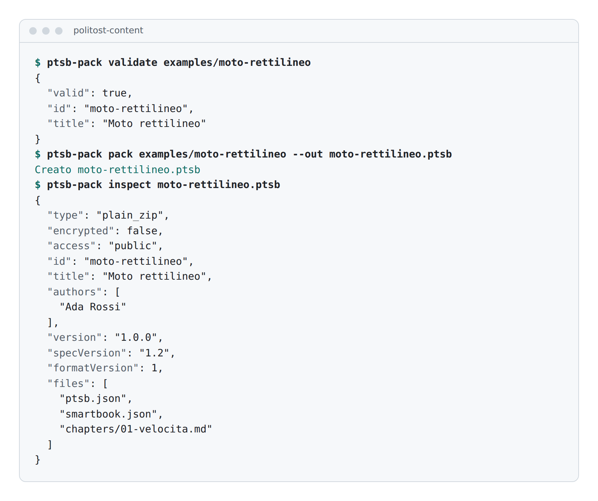

<p align="center">
  <picture>
    <source media="(prefers-color-scheme: dark)" srcset="docs/logo/ptsb-lockup-dark.svg">
    
  </picture>
</p>

<p align="center">
  A smartbook is an interactive textbook written in Markdown, with numbered formulas, exercises, past exams and graphs.<br>
  This repository holds the format spec, the code that reads and checks it, and the CLI that packs a book into one .ptsb file.
</p>

<p align="center">
  <a href="https://github.com/SuperTost100/politost-content/releases/latest"></a>
  <a href="https://github.com/SuperTost100/politost-content/actions/workflows/ci.yml"></a>
  <a href="#license"></a>
</p>

<p align="center">
  <a href="#install">Install</a> ·
  <a href="#documentation">Documentation</a> ·
  <a href="CONTRIBUTING.md">Contributing</a>
</p>

<picture>
  <source media="(prefers-color-scheme: dark)" srcset="docs/screenshots/pack-dark.png">
  
</picture>

## What's here

| Package                                           | What it is                                                                                                              |
| ------------------------------------------------- | ----------------------------------------------------------------------------------------------------------------------- |
| [`spec/`](spec)                                   | The content format specification, in Italian like the books. The version is in [`spec/VERSION`](spec/VERSION), now 1.2. |
| [`packages/content-core/`](packages/content-core) | `@politost/content-core`: TypeScript parser, renderer, validators and `.ptsb` reader and writer.                        |
| [`packages/ptsb-pack/`](packages/ptsb-pack)       | `ptsb-pack`: Python CLI that validates a book folder, packs it into a `.ptsb` file, encrypts it and inspects it.        |

The [example book](examples/moto-rettilineo) has one chapter and passes both validators. Everything runs on your machine. There is no server and no account. The [Smartbook reader](https://github.com/SuperTost100/politost-smartbook) and [Pyxis](https://github.com/SuperTost100/politost-pyxis) open `.ptsb` files, and [Smart Builder](https://github.com/SuperTost100/politost-smartbook-builder) writes them. The reader keeps a copy of content-core, Smart Builder pins the release tarball, Pyxis vendors it, and the PoliTost platform vendors ptsb-pack.

## What a smartbook looks like

A book is a folder:

```text
analisi-1/
├── smartbook.json       # title, chapters, format version
├── chapters/
│   ├── 01-numeri-reali.md
│   └── ...
├── esercizi.md          # optional: exercises
├── esami.md             # optional: past exam questions
├── ide.json             # optional: Python lab
├── grafici.json         # optional: graphs
└── assets/              # optional: images
```

A chapter is Markdown with a few `:::` blocks. This is the first paragraph of the [example chapter](examples/moto-rettilineo/chapters/01-velocita.md):

```markdown
## p1 | Velocità media

La velocità media è lo spazio percorso diviso il tempo:

:::formula{id="1.1" label="Velocità media"}
$$v = \frac{s}{t}$$
:::

Come nella {{formula:1.1}}, a parità di spazio un tempo più breve dà una velocità più alta.
```

The [full spec](spec/content-format.md) covers every block, the validation rules and the `.ptsb` package.

## Install

content-core is not on npm. Each release has a tarball attached, which you pin by URL:

```bash
npm install https://github.com/SuperTost100/politost-content/releases/download/content-core-v0.5.1/politost-content-core-0.5.1.tgz
```

The package ships TypeScript source, so use it with a bundler or `tsx`. Add `katex@^0.19.0` to your own dependencies and import its stylesheet, or formulas render wrongly. The [package README](packages/content-core/README.md) has the details.

ptsb-pack needs Python 3.11 or newer. Install it from a tag:

```bash
pip install "git+https://github.com/SuperTost100/politost-content.git@ptsb-pack-v1.2.0#subdirectory=packages/ptsb-pack"
```

## Usage

Check, pack and inspect a book with the example in this repository:

```bash
git clone https://github.com/SuperTost100/politost-content.git
cd politost-content
pip install -e packages/ptsb-pack
ptsb-pack validate examples/moto-rettilineo
ptsb-pack pack examples/moto-rettilineo --out moto-rettilineo.ptsb
ptsb-pack inspect moto-rettilineo.ptsb
```

`pack` refuses any book the reader would refuse, so a package it writes opens in the reader. To encrypt a book for the PoliTost platform, set a secret first. content-core detects encrypted packages and refuses to open them, because decrypting needs the platform.

```bash
export PTSB_MASTER_SECRET="<32 or more random characters>"
ptsb-pack pack examples/moto-rettilineo --out moto-rettilineo.ptsb --encrypt
```

| Variable             | Required                   | What it does                                                                        |
| -------------------- | -------------------------- | ----------------------------------------------------------------------------------- |
| `PTSB_MASTER_SECRET` | Only with `pack --encrypt` | Secret that wraps the book key. `--master-secret @env:NAME` reads another variable. |

Read the same file from TypeScript. Save this as `read.ts` next to the `.ptsb` file and run it with `npx tsx read.ts`:

```ts
import { readFileSync } from 'node:fs';
import { parseChapterMarkdown, readPtsb } from '@politost/content-core';

const book = readPtsb(readFileSync('moto-rettilineo.ptsb'));
console.log(`${book.config.title}, ${book.config.chapters.length} chapter(s)`);
console.log('warnings:', book.warnings);

const chapter = parseChapterMarkdown(book.chapterFiles['01-velocita.md'], 1);
console.log(chapter.paragraphs.map((p) => p.title));
console.log(chapter.formulas);
```

```text
Moto rettilineo, 1 chapter(s)
warnings: []
[ 'Velocità media', 'Un esempio' ]
[
  {
    id: '1.1',
    chapter: 1,
    number: 1,
    label: 'Velocità media',
    latex: '$$v = \\frac{s}{t}$$'
  }
]
```

`readPtsb` throws when the book is invalid. Show `book.warnings` to readers, especially when a book declares a newer format version. The other exports (`validateChapter`, `validateBundle`, `renderContent`, `packBook` and more) are listed in the [content-core README](packages/content-core/README.md#exports).

## Development

You need Node.js 22 and Python 3.11 or newer. CI uses Node 22 and Python 3.13. The two packages are tested separately:

```bash
cd packages/content-core
npm ci
npm test            # tsx --test
npm run typecheck
```

```bash
cd packages/ptsb-pack
pip install -e . pytest
pytest tests/ -q
```

[CONTRIBUTING.md](CONTRIBUTING.md) explains how to change the format and how to release.

## Documentation

| Read this                                       | To learn                                                  |
| ----------------------------------------------- | --------------------------------------------------------- |
| [Format specification](spec/content-format.md)  | Every block, the validation rules and the `.ptsb` package |
| [content-core](packages/content-core/README.md) | Exports, the KaTeX version rule and the release notes     |
| [ptsb-pack](packages/ptsb-pack/README.md)       | The CLI commands (in Italian)                             |
| [Contributing](CONTRIBUTING.md)                 | Changing the format, running the tests and releasing      |

## History

Until October 2026 this was three repositories. This one was called `politost-content-core`, and GitHub redirects the old name. `politost-content-format` and `politost-ptsb-pack` were merged into it with their history. Their old commits sit behind the import merges, so `git log -- spec` does not reach them. Use `git log 21dfcac^2` (content-format) and `git log eb7e5e6^2` (ptsb-pack).

## License

Each part carries its own license. The spec and ptsb-pack are [AGPL-3.0](spec/LICENSE). content-core is [MIT](packages/content-core/LICENSE), so other apps can embed the parser. Books written in the format belong to their authors.
